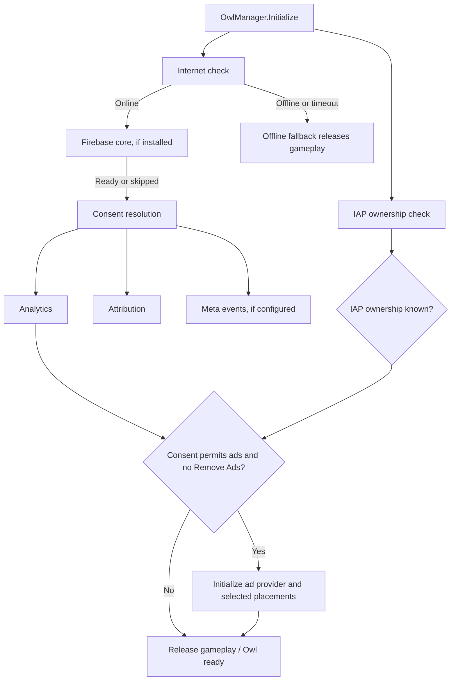

# Owl Publishing Kit

Owl is a Unity toolkit for mobile game publishing services. It coordinates startup, privacy and consent gates, in-app purchase ownership, ads, analytics, attribution, Firebase products, and push notifications from one Owl Settings window.

This repository is a Unity Package Manager (UPM) package. After installation, a small editor installer copies the Owl assets into `Assets/Owl`, where the runtime scripts can compile together with the optional provider SDKs in the project. The package is not a full Unity project; project settings, provider SDKs, developer credentials, and ad configuration assets are not included.

## Contents

- `Assets/Owl/` — installed Unity assets, scripts, prefabs, editor tools, settings resources, and UI.
- `Assets/Owl/Common/Resources/OwlSettings.asset` — default Owl settings asset.
- `Assets/Owl/Common/Resources/OwlManager.prefab` — manager prefab used by the editor menu.
- `Assets/Owl/Utility/Prefabs/OwlStatusCanvas.prefab` — optional runtime flow diagnostics overlay.

The editor creates an ad configuration asset in your project when you first open Owl Settings if one does not exist. Configure your own ad IDs and provider settings there. The primary folders are `Common` (settings, bootstrap, editor window), `Monetization` (ad and IAP flows), `Analytics` (analytics and attribution), `Notifications` (Firebase Messaging), and `Utility` (consent, internet checks, UI, and diagnostics).

## Requirements

- A Unity project. The source project is currently authored with Unity `6000.3.8f1`; other editor versions have not been validated in this repository.
- Unity UI (uGUI) for Owl's settings and UI prefabs.
- Unity In-App Purchasing 5.5.0 (installed as a package dependency).
- Provider SDKs for the integrations you turn on. They are optional and are not bundled here.

## Install through Unity Package Manager

### Package Manager window

1. In Unity, open **Window > Package Management > Package Manager**.
2. Click **+ > Add package from git URL…**.
3. Enter this URL:

   ```text
   https://github.com/sadiqhusaini/OwlPublishingKit.git
   ```

4. Click **Add**. The package installs its assets into `Assets/Owl` automatically and selects that folder in the Project window. Use **Owl > Show Installed Assets** any time to locate it again.

If `Assets/Owl` already exists, automatic installation leaves it untouched. Use **Owl > Install or Update Assets** to update it; Unity asks before overwriting the folder's package files. Updates preserve existing `.meta` files and their GUIDs so scene and prefab references continue to point to the installed assets. Back up project changes before updating.

### Project manifest

To add the package directly in `Packages/manifest.json`, add this entry to the `dependencies` object:

```json
"com.sadiqhusaini.owl-publishing-kit": "https://github.com/sadiqhusaini/OwlPublishingKit.git#main"
```

For reproducible builds, replace `main` with a release tag or commit hash once you publish one. The package installs uGUI, In-App Purchasing, Unity Services Core, and iOS Advertising Support dependencies. Its source assets are copied into `Assets/Owl` so Owl scripts and SDK integrations compile in the project. Ad, analytics, attribution, Firebase, and Meta SDKs remain optional; install the ones you enable from their publishers or the **Owl > SDKs** menu.

### Complete setup

1. Add the package using either method above.
2. Open **Owl > Settings**. Configure the providers/features you need and save. Owl creates a project-local ad configuration asset when needed; set your own ad unit IDs.
3. Use **Owl > Create Owl** to add the Owl manager to the active scene. Place it in an early scene that remains alive during startup.
4. Enable **Automatic startup** in Owl Settings, or call `OwlManager.Initialize()` after the manager is present to start manually.

The package does not include a game's `ProjectSettings`, service configuration files, credentials, or ad unit IDs. Those belong to each consuming Unity project.

## Optional provider SDKs

Install only the providers your game uses. The Owl editor menu includes install/download shortcuts under **Owl > SDKs**. Follow each provider's current platform setup guide and terms.

| Provider | Owl integration |
|---|---|
| Google Mobile Ads (AdMob) | App Open, Banner, Interstitial, Rewarded, Rewarded Interstitial, and MREC placements |
| AppLovin MAX | App Open, Banner, Interstitial, Rewarded, and MREC placements; Rewarded Interstitial is not supported by this integration |
| Unity In-App Purchasing | Product setup, purchase flow, restore flow, and Remove Ads entitlement |
| Firebase | Core initialization, Analytics, Crashlytics, Remote Config, and Cloud Messaging |
| GameAnalytics | Game and progression events, when selected in Owl Settings |
| Meta (Facebook) Unity SDK | Meta app activity, purchase, level, and ad events, gated by Owl consent |
| Airbridge / SolarEngine | Mobile measurement and supported event forwarding, gated by attribution consent |

Owl does not ship vendor SDK binaries or project credentials. Download/import provider SDKs from their publishers, add the platform configuration files your app requires, and use test IDs while developing. Keep app secrets, service account keys, signing keys, and live credentials out of public repositories.

## Configure Owl Settings

Open **Owl > Settings** and use the Development, Analytics & LiveOps, and Monetization sections.

### Development

- **Automatic startup** — start Owl from the manager component. If off, call `OwlManager.Initialize()` yourself.
- **Status overlay** — show the Owl flow diagnostic canvas at runtime. It reports startup state, service readiness, consent, ad placement state, and recent events. Adjust its text size with the slider and scroll through the report.
- **Verbose logs** and **Test ad IDs** — development diagnostics and test ad behavior.
- **No Internet popup** — enable/disable the offline message UI.
- **Ad is coming panel** and **Countdown step** — control the pre-ad countdown UI and its wait interval.
- **Banner background** and **MREC background** — show or hide backing layers behind these placements.
- **IAP loading panel** — show or hide the purchase/restore processing overlay.

The optional UI settings are disabled by default where indicated in Owl Settings; assign/configure the corresponding Owl UI components if your project uses them.

### Analytics & LiveOps

- Select an analytics provider: None, Firebase, GameAnalytics, or Firebase + GameAnalytics.
- Select an attribution provider: None, Airbridge, SolarEngine, or the configured combination.
- Enable Firebase Analytics, Crashlytics, Remote Config, and Push Messaging individually.
- Enable Meta events if the Meta Unity SDK is installed and configured.
- Choose whether Firebase Messaging requests notification permission on startup. If off, request permission from your own UI.

Firebase core starts after Owl detects connectivity. Firebase-dependent products initialize after core readiness, while consent gates analytics, attribution, and ads. Remote Config can control ad placements when the corresponding remote controls are enabled in settings.

### Monetization

Choose **No Ads**, **AdMob**, or **MAX**, then configure each placement and its ad units. The actual ad IDs are stored in your game's generated ad settings asset, not in this repository.

- **App Open** — initialize through the startup flow when enabled; start delay is configurable.
- **Banner** — optionally initialize/show on startup. Otherwise call `AdManager.ShowBanner()` when appropriate. Position and show-on-start are configurable.
- **Interstitial** — choose startup initialization or initialize manually; configure the minimum interval and rewarded-ad reset behavior.
- **Rewarded Interstitial** — choose startup initialization or initialize manually. This format is available with the AdMob integration only.
- **Rewarded** — choose startup initialization or initialize manually.
- **MREC** — initialize/show on demand with `AdManager.ShowMREC(...)`.
- **Timed ads** — optionally start an interstitial timer automatically and set its repeat interval.

Each placement must be enabled in Owl Settings and allowed by consent, remote controls, provider support, and Remove Ads ownership before it can request/show ads. A placement being initialized does not mean an ad has loaded or is available yet.

## Startup flow

Owl starts IAP ownership checks and the internet check at startup. Firebase core begins after connectivity is available. Consent is then resolved; analytics, attribution, and Meta events initialize under their consent gates. Ads start only after IAP ownership and analytics startup have resolved, and only when ad consent allows requests and Remove Ads is not owned. Timeouts/fallback paths let gameplay continue without waiting forever for optional services.



`OwlManager.OnSDKInitialized` is raised when startup releases gameplay. It may also release after a degraded fallback, so check individual service readiness before depending on optional providers.

## Initialize ads when needed

Interstitial, Rewarded Interstitial, and Rewarded placements can be initialized from the settings at startup or explicitly after Owl/ad SDK readiness:

```csharp
using Owl;
using Owl.Monetization;
using UnityEngine;

public sealed class GameAdHooks : MonoBehaviour
{
    private void OnEnable()
    {
        OwlManager.OnSDKInitialized += OnOwlReady;
    }

    private void OnDisable()
    {
        OwlManager.OnSDKInitialized -= OnOwlReady;
    }

    private void OnOwlReady()
    {
        AdManager.InitializeInterstitial();
        AdManager.InitializeRewarded();
        AdManager.InitializeRewardedInterstitial(); // AdMob integration only
    }
}
```

These calls respect Owl settings and runtime gates. Calling them before startup is ready will not bypass consent, IAP ownership, provider readiness, or remote controls.

Examples of showing ads after they have been initialized and loaded:

```csharp
AdManager.ShowInterstitial("level_end", () => ContinueGame());

AdManager.ShowRewardedVideo("double_coins", earnedReward =>
{
    if (earnedReward)
        GrantDoubleCoins();
});
```

Other available helpers include `ShowBanner()`, `HideBanner()`, `ShowMREC(BannerPosition)`, `HideMREC()`, `ShowRewardedInterstitial(...)`, and timer controls (`StartTimerAd`, `StopTimerAd`, `ResetTimerAd`). Availability helpers include `IsInterstitialAvailable()`, `IsRewardedVideoAvailable()`, and `IsRewardedInterstitialAvailable()`.

## In-App Purchasing and Remove Ads

1. Install Unity In-App Purchasing from **Owl > SDKs > Install > In-App Purchasing** or Package Manager.
2. Create/configure products in Unity's IAP Catalog.
3. Enable IAP in Owl Settings and use the product IDs in your buttons/offers.
4. Add the product ID(s) that grant Remove Ads to Owl's **No Ads IDs** setting.
5. Use the included IAP button, offer panel, and restore button scripts/prefabs, or call into your own purchase UI.

Owl checks ownership before starting ads. If ownership cannot be confirmed during startup, ads are skipped for that session. A matching Remove Ads purchase suppresses ads.

For products other than Remove Ads, register a persistent `IAPManager.FulfillPurchase` handler before initializing Owl. The handler must grant every item idempotently using the transaction ID, persist the grant, and return `true` only after fulfillment succeeds. Keep it registered when the store UI is closed; without an acknowledging handler, orders remain pending. Owl handles configured Remove Ads products automatically.

## Analytics event helpers

Owl's `AnalyticsManager` sends supported events to the analytics providers selected in Owl Settings, after consent and initialization. Examples:

```csharp
using Owl.Analytics;

AnalyticsManager.TrackLevelStart(1);
AnalyticsManager.TrackLevelComplete(1);
AnalyticsManager.TrackLevelFail(1);
AnalyticsManager.TrackDesignEvent("shop:offer:opened");
AnalyticsManager.TrackCustomEvent("currency_earned", "amount", 50f);
```

The wrapper also includes ad event helpers. Events are ignored when Owl has not initialized analytics or consent does not allow collection. Provider-specific event availability depends on installed SDKs and selected settings.

## Firebase Cloud Messaging

Enable Firebase and Push Messaging in Owl Settings and install/configure Firebase Messaging for each target platform. Owl creates/initializes its messaging service through the Firebase flow. When **Request permission on startup** is off, a game can request permission/token explicitly:

```csharp
using System.Threading.Tasks;
using Owl.Notifications;
using UnityEngine;

public sealed class PushPermissionExample : MonoBehaviour
{
    public async Task EnableNotificationsAsync()
    {
        await FirebaseMessagingService.RequestPermissionAsync();
        string token = await FirebaseMessagingService.GetTokenAsync();
        // Send the token to your own server only if your product needs it.
    }
}
```

The service exposes `OnTokenReceived`, `OnNotificationReceived`, and `OnError` events, plus topic subscribe/unsubscribe helpers. Notification permission and token registration are separate: a completed prompt does not guarantee authorization. Configure Android notification permission and iOS APNs/Firebase setup in the consuming game. Never publish a real registration token.

## Consent and privacy

Owl coordinates ad consent and platform tracking authorization. Analytics and attribution collection have separate consent checks. If your game uses an external CMP or privacy UI, provide the user's analytics and attribution choices with `ConsentManager.SetCollectionConsent(analytics, attribution)`; do not treat that as a substitute for the platform/ad-network consent flow. Integrators are responsible for their privacy notices, platform settings, and applicable consent requirements.

## Remote ad controls

When Firebase Remote Config is enabled, Owl can read these control keys (all boolean):

- `RemoteCompleteAds`
- `RemoteAppOpen`
- `RemoteBanner`
- `RemoteInterstitial`
- `RemoteRewarded`
- `RemoteRewardedInterstitial`
- `RemoteMREC`
- `RemoteTimedAds`

Enable the matching Remote Config controls in Owl Settings and publish values in your Firebase project. Local feature switches and the all-ads gate still apply.

## Runtime diagnostics

Enable **Status overlay** in Development settings to inspect:

- Owl startup state, active startup step, duration, and fallback status.
- Internet status and retry count.
- IAP store state, product count, purchase progress, and last error.
- Firebase core and each enabled Firebase product, FCM token receipt/error, and permission mode.
- Consent gates, selected analytics and attribution providers, and Meta SDK state.
- Ad provider readiness and each placement's enabled, initialized, loaded/available, and startup/manual mode states.
- Configured ad unit counts (IDs are intentionally hidden), active Owl components, and recent timestamped events.

This panel is for development diagnostics; do not expose service tokens or sensitive identifiers in your own logs.

## Troubleshooting

- **A provider shows as not installed:** install/import its SDK, select it in Owl Settings, save, and allow Unity to finish compiling.
- **A scripting define is missing:** confirm the SDK is installed and the matching setting is enabled, then save Owl Settings. Owl synchronizes integration defines from the selection and SDK detection.
- **Ads are skipped:** check IAP ownership, Remove Ads IDs, ad consent, selected provider, placement toggles, remote-config values, and required ad-unit IDs.
- **A placement is initialized but not available:** initialization is not a load guarantee; verify network access, test IDs, provider callbacks, and placement configuration.
- **Firebase remains unavailable:** check network access, Firebase Unity SDK import, platform app configuration files, and Firebase project setup.
- **No push token arrives:** verify Firebase Messaging/APNs or Android setup and notification permission state. Permission completion does not imply authorization.
- **Owl settings do not appear:** confirm the folder is exactly `Assets/Owl`, wait for compilation, and check the Unity Console for compile errors.

## License and third-party SDKs

No license file is included. The repository being public does not by itself grant permission to use, modify, or redistribute the Owl source. Provider SDKs have separate licenses and terms; obtain them from their publishers. The optional third-party Unity Logs Viewer bundled in the source project is intentionally not included here.


## Integration scripting defines

Owl Settings synchronizes its scripting defines when you save, based on selected features and detected SDKs. The main symbols are:

- Ads: `USE_ADMOB`, `USE_MAXADS`
- IAP: `USE_IAP`
- Firebase: `USE_FIREBASE`, `USE_FIREBASEANALYTICS`, `USE_FIREBASECRASHLYTICS`, `USE_FIREBASEREMOTECONFIG`, `USE_FIREBASEMESSAGING`
- Analytics and attribution: `USE_GAMEANALYTICS`, `USE_FACEBOOK`, `USE_FACEBOOK_SDK`, `USE_MMP`, `USE_AIRBRIDGE`, `USE_SOLARENGINE`

A product symbol may remain off when its provider SDK is missing, even if the feature was selected. Check the Owl Settings status text and Unity Console after saving.
